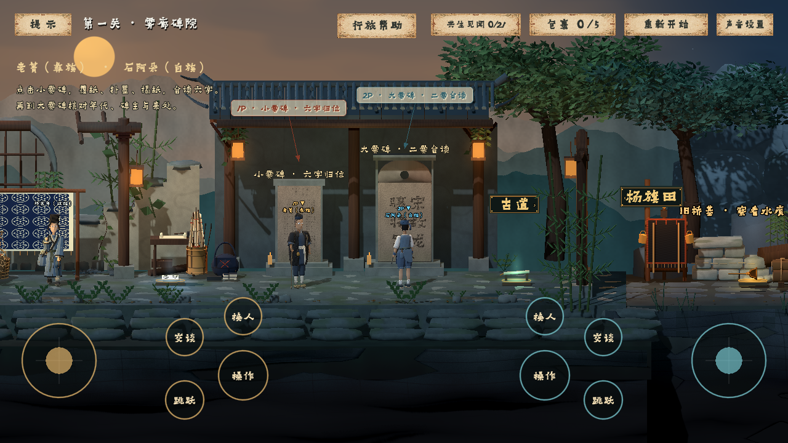
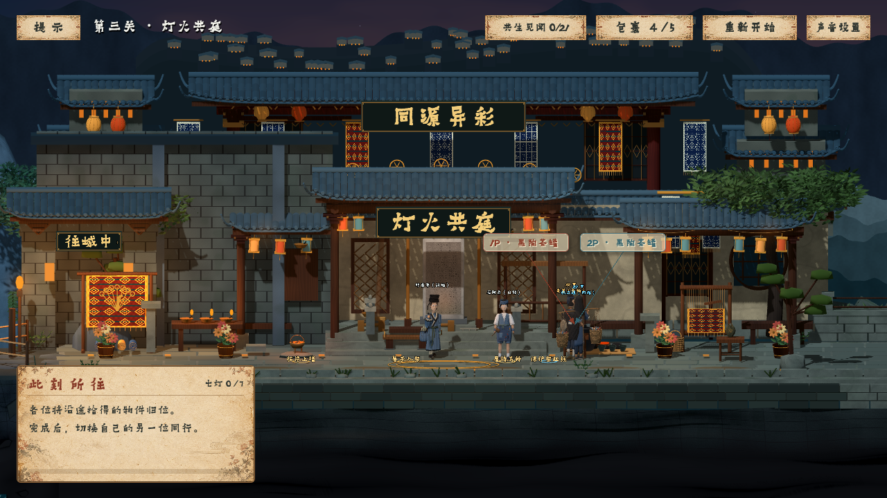
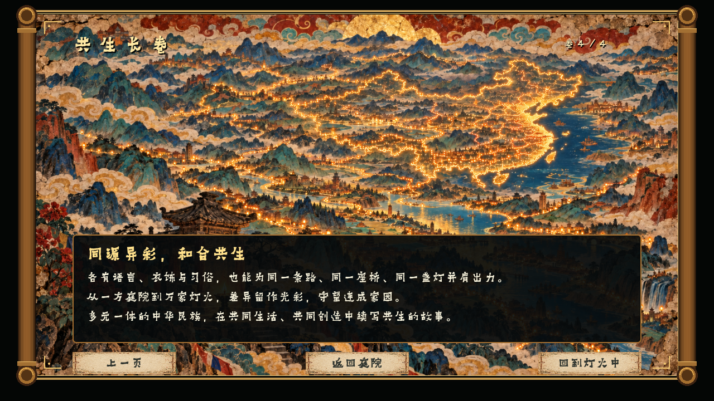

# 爨境·共生

民族交往交流交融主题的三维互动游戏，使用 Godot Engine 4.7.2、GDScript、Shader 与 Blender 模型实现，适配安卓和 Windows。

> **工程文件：**本仓库提供安卓与 Windows 共用的程序源码、Godot 场景、Shader、配置、制作工具和构建说明，供代码审阅。完整可运行工程（包含全部模型、图片、音频、剧情视频、Blender 源文件与所需依赖）见完整工程包 **CuanJingGongSheng-Source-v0.2.1.zip**。本仓库的 Code → Download ZIP 是代码审阅包，不等同于上述完整工程附件。

## 1. 安卓端展示

[安卓安装与操作](docs/ANDROID.md)

版本 0.2.1（3），Android 7.0 / API 24 及以上，64 位 ARM，横屏，离线运行。默认单人触屏，也可选择双人触屏。支持移动、跳跃、长按操作、交谈、切换角色、解碑与器物小艺。

安装包签名、架构、资源完整性和 APK 资源触屏模拟已经检查；尚未在实体安卓手机上安装测试。

## 2. Windows 电脑端

[电脑启动与操作](docs/WINDOWS.md)

完整解压运行附件，保持 CuanParty.exe 与 CuanParty.pck 在同一目录，双击 EXE；支持键盘单人与同屏双人，无需预先安装 Godot。已完成 Windows 原生启动、独立 PCK 加载及成品包 GPU 检查。

## 3. 源码与完整工程

安卓与电脑端共用一套完整 Godot 工程，分别通过移动控制层、键盘控制和导出预设适配。

- scripts/：游戏、合作、谜题、小艺、界面、触屏和剧情的 GDScript 源码。
- shaders/：材质、水体、光晕、步花和烟花等 Shader 源码。
- scenes/：场景和角色入口。
- project.godot、export_presets.cfg：工程入口与双端导出配置。
- tools/：制作、检查和构建工具。
- docs/、assets/legal/：运行、构建、验证范围和素材来源。
- 完整模型、剧情、美术资源及 Blender 工程：见完整源码 ZIP。

**直接运行或重新构建：**解压完整源码 ZIP，使用 Godot **4.7.2** 导入根目录 project.godot，等待资源导入后按 F5 运行。ZIP 内资源已还原、依赖已备齐。[构建说明](docs/BUILD.md)

如果以本仓库为开发起点，先从完整工程附件补齐 assets/ 与 character-source/，再导入工程。仓库中部分资源元数据及来源记录保留供审阅，不能替代实际资源文件。

## 4. 游戏内容

四位同行在碑院合读、断溪护碑、灯火共庭三个连续场景中合作，完成传拓、辨字、修路、救碑、物件归位、点灯与共读长卷。沿途提供器物故事和不同的小艺互动；通关后有彩色步花，全成就后解锁发光彩碑与可交互烟花。

## 5. 素材与使用范围

代码可审阅不代表全部素材采用自由开源许可。字体、照片和引擎组件按原有说明使用，见 [素材说明](docs/ASSETS.md) 和 assets/legal/。字库不设公开下载镜像；官方获取及校验工具随工程保留。签名私钥、密码、SDK、开发机缓存和个人凭据未上传。故事、长卷、场景为艺术创作，不作为民族生活的普遍描述或历史建筑复原。
